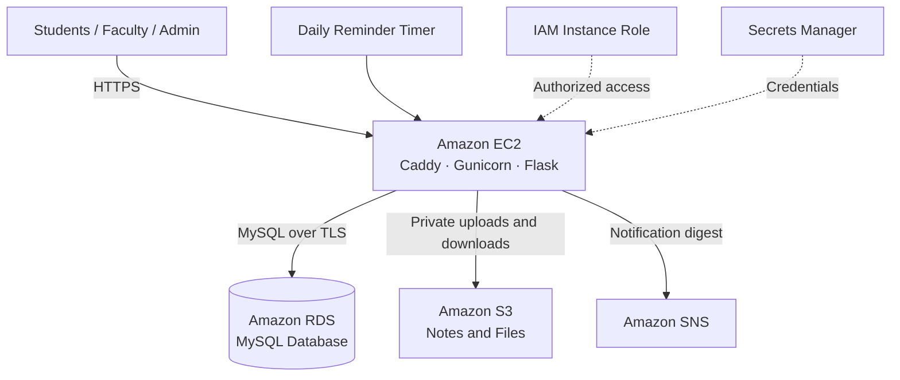

# Dayananda Sagar Campus

**Dayananda Sagar College of Engineering**
Information Science & Engineering · Cloud Computing Laboratory Project

A campus portal that connects students, faculty and administrators through one web application. Built with **Flask and MySQL**, the project demonstrates cloud hosting, managed databases, object storage, secure access and notification automation using **Amazon Web Services**.

## Features

| Role | Features |
|---|---|
| **Student** | Profile, attendance, marks, notes, ID card, fee statement, receipts and notification inbox |
| **Faculty** | Attendance and marks management, notes links, file uploads, profile and ID card |
| **Admin** | Student and faculty management, notices, fee charges, payment records and reminder checks |

The laboratory dataset includes **10 faculty accounts** and **5 Information Science subjects**. Profiles and fee amounts are fictional records. The portal records received payments; it does not process online payments.

## Cloud Architecture



The application separates **presentation**, **business logic** and **data storage**. EC2 serves the website from a public subnet. RDS remains in private subnets and accepts database connections only from the application server. S3 stores uploaded files, while MySQL stores their metadata and campus records.

## Cloud Computing Concepts

### Essential Characteristics

| Concept | Connection to This Project |
|---|---|
| **On-demand self-service** | Provision AWS resources when needed through the console and CloudFormation |
| **Broad network access** | Access the deployed campus portal through a browser over HTTPS |
| **Resource pooling** | Use AWS infrastructure shared across customers with logical isolation |
| **Rapid elasticity** | AWS supports changing capacity; this lab uses fixed-size instances without Auto Scaling |
| **Measured service** | Compute time, storage and service requests are metered; resource size and duration affect usage |

### Service and Deployment Models

- **Infrastructure as a Service (IaaS):** EC2 provides virtual compute; the project configures its operating system and application runtime.
- **Managed database service (DBaaS):** RDS manages the MySQL database infrastructure; the application manages its tables and queries.
- **Object storage:** S3 stores files as objects identified by keys, separately from relational data.
- **SaaS-style access:** Students and staff use the portal through a browser without installing or managing server software.
- **Public cloud deployment:** Infrastructure runs on AWS. Private subnets and buckets restrict access within the public cloud.

### Concepts Demonstrated by the Implementation

| Concept | Implementation |
|---|---|
| **Virtualization** | Flask runs on an EC2 virtual machine |
| **Separation of compute and storage** | EC2 handles requests, RDS stores records and S3 stores files |
| **Infrastructure as Code** | CloudFormation defines networking, services, permissions and stack outputs |
| **Network isolation** | VPC subnets and security groups restrict database access |
| **Least privilege** | The EC2 role accesses only the deployment's bucket, topic and required secrets |
| **Encryption** | HTTPS, database TLS, encrypted RDS storage and encrypted S3 objects |
| **Automation** | Startup installation, scheduled reminder checks and SNS publishing |
| **Portability** | Environment variables select local or cloud database and file-storage settings |
| **Cost management** | Small resources are provisioned for the lab and deleted after testing |

**Shared responsibility:** AWS manages the underlying cloud infrastructure. The project manages application security, access permissions, data handling and software maintenance on EC2.

## AWS Services

| Service | Purpose |
|---|---|
| **EC2** | Hosts Flask with Gunicorn and Caddy HTTPS |
| **RDS for MySQL** | Stores accounts, academic records, fees, receipts and notifications |
| **S3** | Stores private notes and the deployment archive |
| **SNS** | Accepts generic notification digests |
| **VPC and Security Groups** | Separate public/private subnets and restrict network access |
| **IAM** | Provides instance-role access without embedded AWS access keys |
| **Secrets Manager** | Stores generated cloud database and portal credentials |
| **CloudFormation** | Provisions and removes infrastructure as one stack |

## Key Workflows

**Academic records:** Faculty manage attendance and marks. Students view their own records and department learning resources.

**Fees and receipts:** Admin records a fee charge or received payment. MySQL updates the balance and receipt, and the student receives an inbox notification. Unique receipt references and balance checks prevent duplicate or excessive payment entries.

**Learning resources:** Faculty upload PDF, TXT or DOCX files up to **20 MB**, or share a resource link. Cloud uploads remain private in S3. Authenticated downloads use signed URLs valid for **five minutes**.

**Notification automation:** Checks generate reminders for unpaid fees due within seven days or overdue, attendance below **75%**, and active department notices. Repeated checks avoid duplicates. Admin can run checks manually; the cloud timer schedules them at approximately **09:00 India time**.

SNS receives a generic digest without individual student identifiers or fee amounts. Email delivery requires a confirmed SNS subscription. Signup and password recovery require SMTP configuration.

## Technology Stack

| Layer | Technologies |
|---|---|
| Frontend | HTML, CSS, Bootstrap, JavaScript |
| Backend | Python, Flask, Flask-WTF, WTForms |
| Database | MySQL, Flask-MySQLdb |
| Cloud Integration | Boto3, AWS |
| Hosting Runtime | Amazon Linux, Gunicorn, Caddy, systemd |

Database definitions: [schema.sql](schema.sql) and [services_schema.sql](services_schema.sql).

## Local Setup

**Requirements:** Python, MySQL Server and the client libraries required by `mysqlclient`.

### 1. Install Dependencies

```powershell
py -m venv .venv
.\.venv\Scripts\python.exe -m pip install -r requirements.txt
```

### 2. Prepare the Database

Create the MySQL database `institute_db`, then import `schema.sql` and `services_schema.sql` using MySQL Workbench or the MySQL client. Populate authorized accounts and records before logging in; private database contents are excluded from Git.

### 3. Configure and Run

```powershell
$env:MYSQL_HOST = "127.0.0.1"
$env:MYSQL_PORT = "3306"
$env:MYSQL_USER = "root"
$env:MYSQL_DB = "institute_db"
$env:MYSQL_PASSWORD = Read-Host "MySQL password"
$env:COOKIE_SECURE = "0"
$env:SECRET_KEY = (& .\.venv\Scripts\python.exe -c "import secrets; print(secrets.token_hex(32))")
.\.venv\Scripts\python.exe -m flask --app app run --host 127.0.0.1 --port 5000
```

Open **[http://127.0.0.1:5000/](http://127.0.0.1:5000/)** and choose a login role. Use [.env.example](.env.example) as a configuration reference; the application does not automatically load that file.

## AWS Deployment and Verification

See [deployment/README.md](deployment/README.md) for provisioning, private release upload, credentials and cleanup.

The AWS deployment on **10 October 2026** verified all three role logins against RDS, fee balances and receipts, student notifications, marks, attendance, private S3 upload/retrieval, SNS digest acceptance and reminder deduplication. The daily timer was configured and its job executed manually.

**Deployment status:** The temporary AWS resources were deleted after testing. The local application and database remain available. The lab used one EC2 instance and Single-AZ RDS; Auto Scaling, load balancing and automatic failover were not configured.

Private credentials, database exports, local uploads and release archives are excluded from Git.
